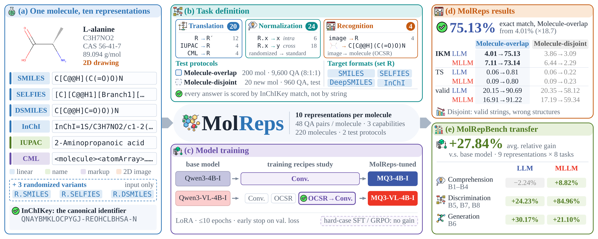

<h1 align="center">
  
  MolReps: Taking SELFIES, Making SMILES, Teaching LLMs
</h1>

<p align="center">
  <a href="https://arxiv.org/abs/2611.20848" target="_blank"></a>
</p>

<p align="center">
  <a href="https://huggingface.co/datasets/kdeng03/mol-reps-v0.1"></a>
  <a href="https://huggingface.co/datasets/kdeng03/mol-rep-ocr-v1.1"></a>
  <a href="https://huggingface.co/datasets/kdeng03/mol-rep-conversion-v1.1"></a>
</p>

<p align="center">
  <a href="https://huggingface.co/kdeng03/MolQwen3-4B-Instruct-SFT"></a>
  <a href="https://huggingface.co/kdeng03/MolQwen3-VL-4B-Instruct-SFT"></a>
</p>

<p align="center">
  <a href="https://github.com/kdeng03">Ken Deng</a>&emsp;
  <a href="https://www.stats.ox.ac.uk/people/garrett-morris">Garrett Morris</a>&emsp;
  <br>
  University of Oxford
</p>

<p align="center">
  
</p>

<p align="center">
  <em>MolReps renders each molecule in ten representations and builds translation, normalization, and 2D structure recognition tasks from them.</em>
</p>

---

The same molecule can be expressed in multiple, syntactically distinct representations, yet it remains unclear whether large language models (LLMs) can recognize and relate these equivalent encodings. We introduce **MolReps**, a pipeline that generates 9,600 question--answer pairs across ten representations for conversion, normalization, and 2D structure recognition. Post-training on MolReps improves text-only and multimodal models, **MolQwen3-4B-Instruct (MQ3-4B-I)** and **MolQwen3-VL-4B-Instruct (MQ3-VL-4B-I)**, from $4.01\%$ to $75.13\%$ and from $7.11\%$ to $73.14\%$ (InChIKey match) on the molecule-overlap test set, respectively. On the molecule-disjoint test set, post-training increased validity from 20.35\% to 58.12\% for MQ3-4B-I and from 17.19\% to 59.34\% for MQ3-VL-4B-I. However, InChIKey match remained low, decreasing from 3.86\% to 3.09\% and from 6.44\% to 2.29\%, respectively. Furthermore, the resulting models achieve a relative $27.84\%$ improvement in average over their base model on MolRepBench, a comprehensive benchmark for evaluating molecular property prediction. These results show the effectiveness of targeted post-training for enhancing molecular representation understanding and its potential to improve downstream molecular tasks.

## Contents

- [Results](#results)
- [Installation](#installation)
- [Quick Start](#quick-start)
- [Repo Structure](#repo-structure)
- [Citation](#citation)

## Results

### MolReps Testset

| Model | Overlap: InChIKey ↑ | Disjoint: validity ↑ | Disjoint: InChIKey ↑ |
|---|---|---|---|
| MQ3-4B-I (base) | 4.01 | 20.35 | 3.86 |
| MQ3-4B-I (SFT) | **75.13** | **58.12** | 3.09 |
| MQ3-VL-4B-I (base) | 7.11 | 17.19 | 6.44 |
| MQ3-VL-4B-I (SFT) | **73.14** | **59.34** | 2.29 |

### MolRepBench

We also evaluate on MolRepBench, a benchmark of eight molecular representation tasks grouped into three categories: comprehension (B1--B4), discrimination (B5, B7, B8), and generation (B6) [Raja et al., 2026](https://arxiv.org/abs/2606.03057). Scores are averaged within each category, then across the three categories.

| Category | MQ3-4B-I base | MQ3-4B-I SFT | MQ3-VL-4B-I base | MQ3-VL-4B-I SFT |
|---|---|---|---|---|
| Comprehension (B1--B4) | 43.9 | 42.9 | 38.6 | 42.0 |
| Discrimination (B5, B7, B8) | 37.4 | 46.5 | 26.4 | 48.8 |
| Generation (B6) | 24.1 | 31.3 | 25.9 | 31.3 |
| **Overall** | 35.1 | **40.2** | 30.3 | **40.7** |

Averaging the relative gains over the three categories gives **+17.4%** for MQ3-4B-I and **+38.3%** for MQ3-VL-4B-I, a relative **+27.8%** improvement over the base models on average.

## Installation

```bash
git clone https://github.com/kdeng03/MolReps.git
cd MolReps
pip install rdkit selfies deepsmiles pubchempy datasets transformers trl peft accelerate vllm pandas pyarrow jsonlines tqdm numpy
```

## Quick Start

All scripts run from the repository root with `PYTHONPATH="$(pwd)"` and read their task and model definitions from `configs/`.

```bash
# 1. Generate the source dataset and the QA pairs
python scripts/gen_mol_reps.py
python scripts/gen_mol_rep_conversion.py

# 2. Supervised fine-tuning
PYTHONPATH="$(pwd)" accelerate launch scripts/sft.py \
    --task_name mol_rep_conversion \
    --model_name qwen3_vl_4b_i \
    --training_method sft_lora

# 3. GRPO with TRL (scripts/bash/grpo_verl.sh for the VERL version)
PYTHONPATH="$(pwd)" accelerate launch scripts/grpo_trl.py \
    --task_name mol_rep_conversion \
    --base_model_name qwen3_vl_4b_i \
    --parent_training_method sft_lora \
    --training_method grpo_lora

# 4. Inference and pass@k evaluation
python scripts/inference.py --model_name qwen3_vl_4b_i_sft_lora_conversion
python scripts/eval_pass_at_k.py \
    --engine_name qwen3_vl_4b_i_sft_lora_conversion \
    --dataset_name kdeng03/mol-rep-conversion-v1.1 \
    --dataset_split test --max_k 16
```

`--task_name` accepts `mol_rep_conversion`, `mol_rep_ocr`, or `mol_rep_ocr_conversion`. The `--model_name` and `--engine_name` keys must exist in `configs/model_training_schema.yaml` and `configs/model_inference_schema.yaml` before training or evaluating a new model. Ready-to-run SLURM wrappers are in `scripts/bash/`.

## Repo Structure

```
configs/   representation schema and training / inference / ablation configs
scripts/   data generation, training, inference, and evaluation entry points
src/       representation core (dataset/) and the vLLM engine (inference/)
assets/    teaser figure and logo
```

## Citation
```bibtex
@misc{deng2026molrepstakingselfiesmaking,
      title={MolReps: Taking SELFIES, Making SMILES, Teaching LLMs}, 
      author={Ken Deng and Garrett Morris},
      year={2026},
      eprint={2611.20848},
      archivePrefix={arXiv},
      primaryClass={physics.chem-ph},
      url={https://arxiv.org/abs/2611.20848}, 
}
```
